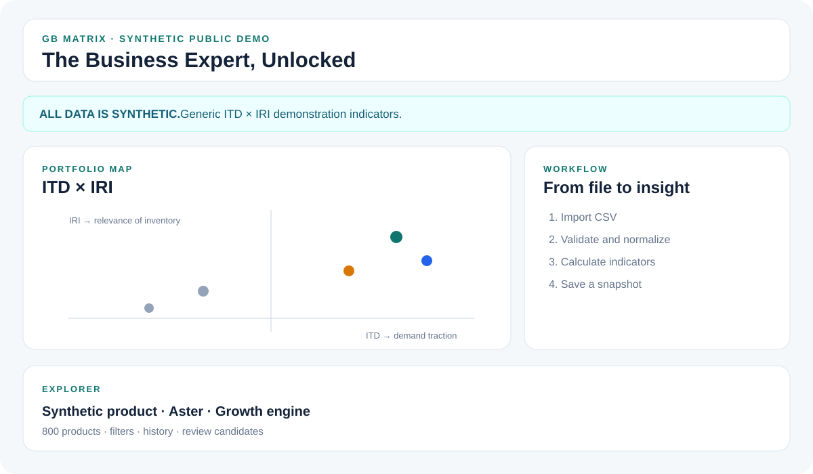

# GB Matrix (Matriz GB) — The Business Expert, Unlocked

*From business expertise to a working decision system, then to verifiable Codex-assisted engineering.*

Pablo Atienza is a marketing and business-intelligence professional in Argentina with 25+ years of experience. Using ChatGPT, he directed the creation of **GB Matrix**, an operational approach to prioritizing a multi-brand product portfolio. The original artifact combines demand traction (ITD), inventory relevance (IRI), reviewable product-level evidence, filters, drill-down and tabular views, model comparison, backtesting, and source reconciliation. His domain decisions also established **two complementary scopes: exact SKU records and normalized commercial product families**. Codex subsequently created an **independent, public and testable demonstration** of the concept: 800 entirely synthetic products, 12 periods, modular JavaScript, a CSV update flow, 15 passing tests, GitHub Actions, a reviewed pull request and a traceable development history. The first bilingual tutorial is published; the ongoing teaching series shows business experts how to direct, test and maintain software with Codex. The commercial tool and synthetic demonstration are separate implementations.

[**Open live demo**](https://mccpabloatienza-oss.github.io/gb-matrix-codex-public/) · [**Reviewer case (HTML)**](https://mccpabloatienza-oss.github.io/gb-matrix-codex-public/case-study.html) · [**Full source-backed case**](docs/CASE_STUDY_FOR_REVIEWERS.md) · [**CI run**](https://github.com/mccpabloatienza-oss/gb-matrix-codex-public/actions/runs/40451410979) · [**PR #2**](https://github.com/mccpabloatienza-oss/gb-matrix-codex-public/pull/2) · [**Intro video**](https://www.youtube.com/shorts/JTkRiMG96o4)



## Evidence at a glance

| Auditable Codex demo evidence | Recorded result | Where to verify |
|---|---|---|
| Synthetic portfolio | 800 invented products; 5 fictional brands; 6 generic categories; 12 periods; fixed seed `20261026` | `scripts/generate_demo_data.js` |
| Automated tests | 15 passing tests | `npm test`; [successful CI](https://github.com/mccpabloatienza-oss/gb-matrix-codex-public/actions/runs/40451410979) |
| Source and maintenance | Modular JS, CSV parsing and update flow, validation, period append and local snapshots | `src/`, `tests/`, `TEST_REPORT.md` |
| Source review | PR #2, commits, development log, recorded owner decisions | [PR #2](https://github.com/mccpabloatienza-oss/gb-matrix-codex-public/pull/2) · [commits on main](https://github.com/mccpabloatienza-oss/gb-matrix-codex-public/commits/main/) |
| Repository audit | Custom audit script; **38 files / 0 findings** in the latest verified CI run | `scripts/audit_public_repo.js` and PR #2 |
| Publication | GitHub Pages deploy and public repository | [Live demo](https://mccpabloatienza-oss.github.io/gb-matrix-codex-public/) |

**ALL DEMO DATA IS SYNTHETIC. NO REAL COMMERCIAL RECORDS ARE INCLUDED.** The demonstration's ITD/IRI formulas are generic and are not the original company's production formulas. The historical enterprise artifact and its data remain private.

## What the working concept demonstrates

- **From scattered data to decisions:** ITD × IRI positions products; quadrants help prioritize attention, and drill-down, tables and supporting evidence explain why.
- **Methodological review:** candidate demand and inventory indicators were compared, backtested and revised; uncertain classifications and differences between sources were surfaced rather than silently guessed away.
- **Human judgment translated into an artifact:** in the historical tool, an actual business problem required combining exact identifiers with normalized titles, models and categories to create a second, family-level view. **Brand 1 and Brand 2 are anonymized real-world contexts**, not invented case histories.
- **Codex contribution:** modular synthetic implementation, reproducible generation, validation, a monthly CSV workflow, a test suite and CI. Codex is **not** credited with building the original ChatGPT-developed tool.

The later security review added HTML escaping for imported labels, plus two regression tests; all 15 tests and the custom 38-file audit passed in the latest CI run. [QA issue #4](https://github.com/mccpabloatienza-oss/gb-matrix-codex-public/issues/4) tracks the still-pending manual browser file-chooser test.

**Boundary:** commercial-family grouping exists in the private historical artifact; it is documented as a design decision here and is **not implemented in the public synthetic demo**. The demo's CSV upload via the native browser chooser requires a separate manual UI check; parser and update logic are covered by automated tests.

## Run and reproduce

```bash
npm run generate
npm test
npm run check
node scripts/audit_public_repo.js
python -m http.server 8000
```

Open `http://localhost:8000`. Node.js LTS is required; no paid backend.

## Public examples of content and communication

The candidate also supplied five earlier published Instagram/YouTube examples, curated separately from Codex engineering evidence. [**View the creator's portfolio and public content links**](https://mccpabloatienza-oss.github.io/gb-matrix-codex-public/creator-portfolio.html).

## For reviewers and learners

- [Detailed, source-scoped case study](docs/CASE_STUDY_FOR_REVIEWERS.md)
- [README en español](README_ES.md)
- [Codex development record](CODEX_DEVELOPMENT_LOG.md)
- [Recorded human decisions](HUMAN_DECISIONS.md)
- [Prompt history and scope](PROMPT_HISTORY.md)
- [Before and after](BEFORE_AND_AFTER.md)
- [Test report](TEST_REPORT.md)
- [Reproduction](docs/REPRODUCE.md)
- [Recorded security review](docs/SECURITY_REVIEW.md)
- [Published Tutorial 01 — Spanish / English](https://mccpabloatienza-oss.github.io/gb-matrix-codex-public/tutorial-01.html) · [Editorial issue](https://github.com/mccpabloatienza-oss/gb-matrix-codex-public/issues/3)

**Audience:** Spanish-speaking business and marketing experts with deep domain knowledge and limited engineering support. **Content proposal:** one reproducible Spanish/English tutorial or live demonstration per month, based on implemented work and inspectable tests.
